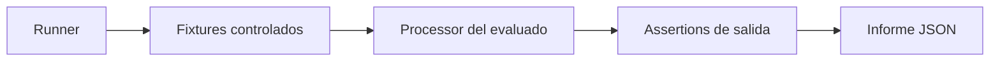

# Laboratorio 00: evaluacion automatica del playground

## Proposito

Este laboratorio comprueba que una persona puede construir y operar pipelines de
Atlas Stream Processing sin seguir una receta manual durante la evaluacion. El
runner prepara datos de prueba, ejecuta el pipeline entregado y valida sus
resultados con criterios observables.

La evaluacion usa un proyecto Atlas dedicado y nombres aislados. No usa datos de
clientes, credenciales en archivos ni recursos de produccion.

## Como funciona



El evaluado solo necesita entregar los processors o completar las tareas
indicadas. Durante la ejecucion no debe insertar datos manualmente, cambiar el
pipeline ni intervenir para corregir errores.

## Niveles de evaluacion

### Nivel 1: nucleo ASP

Evalua los laboratorios 01, 02 y 03 con recursos Atlas y datos controlados:

| Escenario | Evidencia automatica |
|---|---|
| 01 Sample | processor activo, eventos entregados y `timestamp` valido |
| 02 Change Stream | vista por entrega con estado mas reciente |
| 03 Ruuvi | maximo de aceleracion por sensor en una ventana |

Este nivel es el camino recomendado para una primera evaluacion porque no
requiere Kafka, HTTP externo ni AWS.

### Nivel 2: integraciones

Evalua los laboratorios 04, 05 y 06 mediante adaptadores de prueba:

| Escenario | Adaptador | Evidencia automatica |
|---|---|---|
| 04 Late data join | fuente Kafka controlada | join, lateness y reparacion DLQ |
| 05 HTTP enrichment | servidor HTTP local controlado | llamada, mapeo y salida enriquecida |
| 06 CDC to Kinesis | sink Kinesis simulado | eventos aplanados y partition key |

Los adaptadores reproducen el contrato necesario para evaluar el pipeline, pero
no sustituyen una validacion posterior contra Kafka, HTTP o AWS reales.

## Contrato del runner

El runner debe ejecutar estas fases sin preguntas interactivas:

1. Validar herramientas, configuracion y proyecto de pruebas.
2. Crear nombres unicos para workspace, conexiones, processors y colecciones.
3. Preparar fixtures y conexiones del escenario.
4. Crear y arrancar el processor del evaluado.
5. Generar eventos de entrada de forma determinista.
6. Esperar una condicion de salida con timeout.
7. Consultar estado, contadores, salida y DLQ.
8. Evaluar assertions y guardar un informe redactado.
9. Detener y eliminar todos los recursos creados.

El modo por defecto debe ser `CLEANUP=true`. Un modo de inspeccion puede
conservar recursos solo cuando se solicite de forma explicita.

## Criterios comunes

Un escenario pasa solo si:

- el processor se crea y alcanza el estado esperado;
- procesa al menos los eventos minimos del fixture;
- escribe la salida en el namespace correcto;
- respeta la forma y los tipos de datos esperados;
- no necesita cambios manuales durante la ejecucion;
- termina sin errores no esperados ni residuos tras la limpieza.

Cada assertion debe tener un identificador estable, por ejemplo:

```text
ASP-01-STATE
ASP-01-OUTPUT
ASP-02-LATEST
ASP-03-WINDOW-MAX
ASP-04-DLQ-REPAIR
ASP-05-ENRICHMENT
ASP-06-PARTITION-KEY
```

## Informe esperado

El runner debe producir un JSON sin secretos con este formato minimo:

```json
{
  "runId": "redacted-run-id",
  "mode": "core",
  "status": "passed",
  "scenarios": [
    {
      "id": "03-ruuvi-motion",
      "status": "passed",
      "assertions": [
        { "id": "ASP-03-WINDOW-MAX", "status": "passed" }
      ]
    }
  ],
  "cleanup": "passed"
}
```

## Resultado pedagogico

La persona demuestra capacidad sobre comportamientos, no sobre copiar nombres
concretos. El runner puede cambiar valores, orden de eventos y nombres de
recursos en cada ejecucion, mientras conserva el contrato funcional.

## Orden recomendado de implementacion

1. Automatizar el nivel 1 para 01-03.
2. Crear assertions deterministas y fixtures versionados.
3. Añadir timeout, limpieza e informe redactado.
4. Implementar adaptadores locales para 04-06.
5. Ejecutar una validacion final con servicios reales como prueba de integracion.
