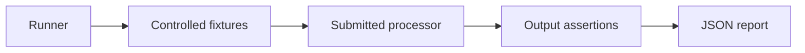

# Lab 00: Playground Infrastructure and Assessment

## Purpose

This lab has two related responsibilities:

1. Prepare and validate the shared infrastructure used by labs 01, 02, 07, and 08.
2. Define automated pipeline assessment using fixtures and assertions.

Detailed instructions for creating the project, cluster, user, workspace, and
connections are in the [infrastructure manual](MANUAL.md). Later labs do not
repeat these steps; they focus on pipelines, observability, and documents created
in the cluster.

The assessment uses a dedicated Atlas project and isolated resource names. It
does not use customer data, credentials stored in files, or production resources.

## How It Works



## Infrastructure Setup

Before creating resources, sign in to Atlas CLI in the terminal with
`atlas auth login` and verify the session with `atlas auth whoami`. If the
session expires, run `atlas auth login` again.

Before continuing, confirm that the shared environment includes:

- a test Atlas cluster and a database user;
- an operational ASP workspace;
- the `sample_stream_solar` connection;
- the `atlas_lab` Atlas connection;
- permission to create and query the lab collections.

After validating the environment, follow this learning sequence:

```text
00 infrastructure -> 01 Sample pipeline -> 02 Change Stream
                    -> 07 observability -> 08 parallelism
```

The participant only needs to submit processors or complete the specified
tasks. The runner must not require manual data insertion, pipeline changes, or
intervention to correct errors during execution.

## Assessment Levels

### Level 1: ASP Fundamentals

Assesses labs 01, 02, and 03 using Atlas resources and controlled data:

| Scenario | Automated evidence |
|---|---|
| 01 Sample | Active processor, delivered events, and a valid `timestamp` |
| 02 Change Stream | Per-delivery view with the latest state |
| 03 Ruuvi | Maximum acceleration per sensor within a window |

This level is recommended for an initial assessment because it does not require
Kafka, an external HTTP service, or AWS.

### Level 2: Integrations

Assesses labs 04, 05, and 06 using test adapters:

| Scenario | Adapter | Automated evidence |
|---|---|---|
| 04 Late data join | Controlled Kafka source | Join, lateness, and DLQ repair |
| 05 HTTP enrichment | Controlled local HTTP server | Request, mapping, and enriched output |
| 06 CDC to Kinesis | Simulated Kinesis sink | Flattened events and partition key |

The adapters reproduce the contract needed to assess the pipeline, but do not
replace subsequent validation against live Kafka, HTTP, or AWS services.

## Runner Contract

The runner must execute these phases without interactive prompts:

1. Validate tools, configuration, and the test project.
2. Generate unique names for workspaces, connections, processors, and collections.
3. Prepare fixtures and scenario connections.
4. Create and start the submitted processor.
5. Generate input events deterministically.
6. Wait for an output condition, with a timeout.
7. Query processor state, counters, output, and DLQ.
8. Evaluate assertions and save a redacted report.
9. Stop and remove all resources created for the run.

The default mode must be `CLEANUP=true`. An inspection mode may retain resources
only when explicitly requested.

## Assessment Criteria

A scenario passes only when:

- the processor is created and reaches the expected state;
- it processes at least the minimum number of fixture events;
- it writes output to the correct namespace;
- it follows the expected data structure and types;
- does not require manual changes during execution;
- completes without unexpected errors or leftover resources after cleanup.

Each assertion must have a stable identifier, for example:

```text
ASP-01-STATE
ASP-01-OUTPUT
ASP-02-LATEST
ASP-03-WINDOW-MAX
ASP-04-DLQ-REPAIR
ASP-05-ENRICHMENT
ASP-06-PARTITION-KEY
```

## Expected Report

The runner must produce a JSON report without secrets, using at least this format:

```json
{
  "runId": "redacted-run-id",
  "mode": "core",
  "status": "passed",
  "scenarios": [
    {
      "id": "03-ruuvi-motion",
      "status": "passed",
      "assertions": [
        { "id": "ASP-03-WINDOW-MAX", "status": "passed" }
      ]
    }
  ],
  "cleanup": "passed"
}
```

## Learning Outcome

Participants demonstrate understanding of behavior rather than memorizing
specific names. The runner may vary values, event order, and resource names in
each run while preserving the functional contract.

## Recommended Implementation Order

1. Automate Level 1 for labs 01–03.
2. Create deterministic assertions and versioned fixtures.
3. Add timeouts, cleanup, and a redacted report.
4. Implement local adapters for labs 04–06.
5. Run final validation against live services as an integration test.
