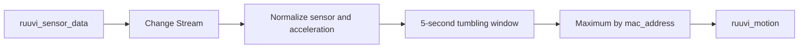

# Lab 03: Ruuvi Motion Aggregation

Reference author: Kenny Gorman.

Source: https://medium.com/mongodb/lets-iot-with-ruuvi-atlas-stream-processing-735d2bac6249

**Overview:** Simulate Ruuvi sensor readings from an Atlas collection and
calculate the maximum acceleration per sensor in five-second windows.

## Data Flow



In summary:

```text
Ruuvi readings -> 5-second window -> maximum acceleration per sensor -> Atlas output
```

## Objective

Calculate each sensor's maximum acceleration in five-second windows without
requiring physical BLE hardware.

## Prerequisites

Before using `ATLAS_URI`, run `./scripts/validate-atlas-connection.sh` from the
project root to detect an outdated hostname.

Before continuing, run `atlas auth login` in the terminal and verify the
session with `atlas auth whoami`. If the session has expired, run
`atlas auth login` again.

Create `atlas_lab`, pointing to the test cluster, and prepare the
`playground.ruuvi_sensor_data` collection. Each document must include
`mac_address`, `time`, and a numeric value in `data.acceleration`:

```javascript
use playground

db.ruuvi_sensor_data.insertOne({
	mac_address: "AA:BB:CC:DD:EE:01",
	time: new Date(),
	data: { acceleration: 1.8 }
})
```

The readings and view use the same Atlas cluster and the `playground` database.
To generate readings without hardware, connect `mongosh` to the Atlas cluster
and run:

```bash
mongosh "$ATLAS_URI"
```

In that session, run:

```javascript
load("[local-repository]/scripts/03-seed-ruuvi.js")
```

The seeder inserts six readings from two sensors, one per second. Run it after
starting the processor so the changes appear in the Change Stream.

## Run the Lab

In another session, connect `mongosh` to the ASP workspace and run:

```javascript
load('[local-repository]/projects/03-ruuvi-motion/processor.js')
sp.labRuuviMotion.start()
sp.labRuuviMotion.stats()
```

Then return to the Atlas cluster session and run the seeder:

```javascript
load("[local-repository]/scripts/03-seed-ruuvi.js")
```

The results are materialized in `playground.ruuvi_motion`, with one document
per sensor and window:

```javascript
use playground
db.ruuvi_motion.find().pretty()
```

The `acceleration` field should contain the highest value received for each
sensor within the five-second window. A later window may replace an earlier
window's reading because the output uses `$merge` with the sensor identifier.

Changes without `fullDocument`, sensors without `mac_address`, and readings
with non-numeric acceleration values are discarded to prevent misleading
results.

## Cleanup

```javascript
sp.labRuuviMotion.stop()
sp.labRuuviMotion.drop()
```

If the lab data is no longer needed:

```javascript
use playground
db.ruuvi_sensor_data.drop()
db.ruuvi_motion.drop()
```

This lab replaces a BLE device with readings inserted into Atlas, allowing it
to run without physical hardware.
