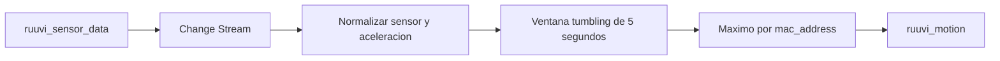

# Laboratorio 03: agregacion de movimiento Ruuvi

Autor de la referencia: Kenny Gorman.

Fuente: https://medium.com/mongodb/lets-iot-with-ruuvi-atlas-stream-processing-735d2bac6249

**Descripcion:** Simula lecturas de sensores Ruuvi desde una coleccion Atlas y
calcula el maximo de aceleracion por sensor en ventanas de cinco segundos.

## Flow sencillo



En una frase:

```text
lecturas Ruuvi -> ventana de 5 segundos -> maximo de aceleracion por sensor -> resultado Atlas
```

## Objetivo

Obtener el maximo de aceleracion de cada sensor durante ventanas de cinco
segundos, sin necesitar hardware BLE real.

## Preparacion

Crea `atlas_lab` apuntando al cluster de prueba y prepara la coleccion
`playground.ruuvi_sensor_data`. Cada documento debe incluir `mac_address`,
`time` y un valor numerico en `data.acceleration`:

```javascript
use playground

db.ruuvi_sensor_data.insertOne({
	mac_address: "AA:BB:CC:DD:EE:01",
	time: new Date(),
	data: { acceleration: 1.8 }
})
```

Las lecturas y la vista viven en el mismo cluster Atlas, dentro de la base
`playground`. Para generar varias lecturas sin hardware, conecta `mongosh` al
cluster Atlas y ejecuta:

```javascript
load("scripts/03-seed-ruuvi.js")
```

El seeder inserta seis lecturas de dos sensores, una por segundo. Ejecutalo
despues de iniciar el processor para que los cambios entren en el Change Stream.

## Ejecucion

En otra sesion, conecta `mongosh` al workspace ASP y ejecuta:

```javascript
load('projects/03-ruuvi-motion/processor.js')
sp.labRuuviMotion.start()
sp.labRuuviMotion.stats()
```

Despues vuelve a la sesion del cluster Atlas y ejecuta el seeder:

```javascript
load("scripts/03-seed-ruuvi.js")
```

El resultado queda materializado en `playground.ruuvi_motion` como un documento
por sensor y ventana:

```javascript
use playground
db.ruuvi_motion.find().pretty()
```

El campo `acceleration` debe corresponder al mayor valor recibido para cada
sensor dentro de la ventana de cinco segundos. Las lecturas de ventanas
anteriores pueden ser reemplazadas por la siguiente ventana porque la salida
usa `$merge` con el identificador del sensor.

Los cambios sin `fullDocument`, sensores sin `mac_address` o lecturas cuya
aceleracion no sea numerica se descartan para evitar resultados engañosos.

## Limpieza

```javascript
sp.labRuuviMotion.stop()
sp.labRuuviMotion.drop()
```

Si ya no necesitas los datos de práctica:

```javascript
use playground
db.ruuvi_sensor_data.drop()
db.ruuvi_motion.drop()
```

Este laboratorio sustituye el dispositivo BLE por lecturas insertadas en Atlas para que pueda ejecutarse sin hardware.
