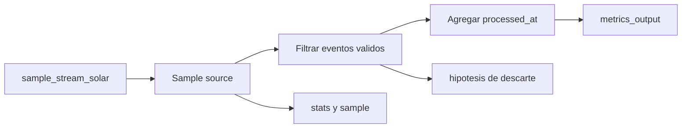

# Laboratorio 07: observabilidad y troubleshooting ASP

**Descripcion:** Ejecuta un processor sobre `sample_stream_solar` y aprende a
observar su estado, los documentos que atraviesan el pipeline y el sink Atlas.

Aprende a interpretar `stats()`, `sample()`, estado del processor, salida en
Atlas y señales de DLQ/logs para diagnosticar fallos de Atlas Stream Processing.

Documentacion oficial relacionada:

- https://www.mongodb.com/docs/atlas/atlas-stream-processing/monitoring
- https://www.mongodb.com/docs/atlas/atlas-stream-processing/quickstart
- https://www.mongodb.com/docs/manual/reference/method/sp.processor.sample

## Objetivo

Entender un processor en operacion: comprobar si existe, si esta arrancado, si
recibe datos, si transforma correctamente, si escribe en el sink y donde mirar
cuando algo no cuadra.

Este laboratorio es la linea base del laboratorio 08. Aqui no se comparan
workers ni se intenta medir rendimiento: primero se separan señales de salud,
flujo, resultado y diagnostico.

## Conceptos ASP

- `sp.listStreamProcessors()` para confirmar existencia del processor;
- `sp.<processor>.stats()` para leer estado y actividad operacional;
- `sp.<processor>.sample()` para observar documentos procesados en vivo;
- comparacion entre fuente, muestra y sink persistido;
- filtros que descartan eventos Sample que no tengan los campos esperados;
- DLQ como evidencia de fallos procesables por el processor;
- logs y Atlas UI como siguiente nivel cuando `stats()` no basta.

## Flow sencillo



En una frase:

```text
sample_stream_solar -> processor observable -> metrics_output -> diagnostico guiado
```

## Preparacion

Necesitas:

- un workspace ASP de pruebas;
- una conexion Atlas llamada `atlas_lab`;
- acceso al cluster Atlas con `mongosh`;
- la conexion Sample `sample_stream_solar`;
- la coleccion `playground.metrics_output`.

Para trabajar con las colecciones del cluster Atlas, conecta con:

```bash
mongosh "$ATLAS_URI"
```

La conexión al workspace ASP es independiente y se realiza con su hostname.

`metrics_output` puede ser creada por `$merge` en la primera escritura.

## Paso 1: arrancar el processor

En `mongosh` conectado al workspace ASP:

```javascript
load("[local-repository]/projects/07-metrics-observability/processor.js")
sp.listStreamProcessors()
sp.labMetricsObservability.start()
sp.labMetricsObservability.stats()
```

Primera lectura: el processor debe existir y estar arrancado. Sample produce
eventos por su cuenta; el ritmo y la cantidad no los controla este laboratorio.

## Paso 2: observar señales del processor

En el workspace ASP:

```javascript
sp.labMetricsObservability.stats()
sp.labMetricsObservability.sample()
```

`stats()` ayuda a saber si el processor esta activo. `sample()` muestra documentos
que ya pasaron el pipeline; si no aparece nada, no asumas aun que el processor
esta roto.

## Paso 3: comparar fuente y sink

En el cluster Atlas:

```javascript
use playground

db.metrics_output.countDocuments()
db.metrics_output.find().sort({ device_id: 1 }).pretty()
```

Resultado esperado:

- `metrics_output` contiene como maximo un documento por `device_id`;
- una nueva muestra del mismo dispositivo reemplaza su documento anterior;
- cada salida valida contiene `value`, `observed_at`, `processed_at` y
   `lab: "metrics-observability"`;
- la cantidad y el contenido exactos dependen del flujo generado por Sample.

Clasifica las observaciones en tres grupos:

| Tipo de señal | Ejemplos | Pregunta que responde |
|---|---|---|
| Salud | estado de `stats()`, errores, processor existente | ¿El processor esta operativo? |
| Flujo | `sample()`, conteo del sink y actividad de `stats()` | ¿Los eventos atraviesan el pipeline? |
| Resultado | campos de `metrics_output`, reemplazos por `device_id` | ¿La salida es correcta? |

## Paso 5: diagnostico guiado

| Sintoma | Hipotesis | Donde mirar |
|---|---|---|
| No existe el processor | No se ejecuto `load()` o fallo la creacion | `sp.listStreamProcessors()` |
| Existe pero no procesa | No esta arrancado o no llegan eventos nuevos | `stats()`, inserciones recientes |
| `sample()` no muestra datos | No pasaron eventos por el pipeline o ya no hay muestra disponible | `stats()`, sink Atlas |
| Hay actividad pero poca salida | El filtro descarta una muestra sin los campos esperados | comparar `sample()` y `metrics_output` |
| El sink no crece | Problema de conexion, permisos o `$merge` | `atlas_lab`, logs, Atlas UI |
| Aparecen errores | Fallo de operador o documento incompatible | DLQ, logs, `errInfo.reason` |
| La salida cambia de valor | `$merge` reemplaza por `device_id` | `metrics_output.find()` |

## Ideas clave de troubleshooting

1. Empieza por el estado: confirma que el workspace, la conexion y el processor
   existen antes de mirar datos.
2. Separa fuente, pipeline y sink. Un fallo en salida no siempre significa que
   la fuente no emita.
3. Recuerda que Sample genera los eventos: no puedes insertar un lote controlado
   ni exigir una cantidad concreta desde este laboratorio.
4. Usa `sample()` para ver documentos que atraviesan el pipeline, no como unica
   prueba de persistencia.
5. Compara `sample()` y el sink para detectar filtros o reemplazos esperados.
6. Trata la DLQ como evidencia estructurada: revisa `processorName`,
   `operatorName`, `errInfo.reason`, `doc` y `_stream_meta`.
7. No cambies varias cosas a la vez: formula una hipotesis, ejecuta una prueba
   barata y valida si el resultado la confirma.

## Criterio de linea base

Antes de pasar al laboratorio 08, guarda estos resultados de una ejecucion
limpia:

```text
processor: labMetricsObservability
source: sample_stream_solar
sink key: device_id
processor state: STARTED
unexpected errors: 0
```

La linea base no es un benchmark ni exige un numero fijo de documentos. Es un
punto de referencia para distinguir un problema de configuracion de un cambio
de comportamiento introducido por el laboratorio 08.

## Preguntas de comprobacion

Al terminar, la persona deberia poder responder:

- Que comando confirma que el processor existe?
- Que diferencia hay entre `stats()` y `sample()`?
- Por que `metrics_output` conserva como maximo un documento por dispositivo?
- Que campo indica que el processor agrego informacion nueva?
- Donde mirarias si `$merge` no escribe en Atlas?
- Cuando tiene sentido revisar DLQ?

## Limpieza

En el workspace ASP:

```javascript
sp.labMetricsObservability.stop()
sp.labMetricsObservability.drop()
sp.listStreamProcessors()
```

En el cluster Atlas:

```javascript
use playground
db.metrics_output.drop()
```

Este laboratorio no reemplaza la observabilidad de Atlas UI ni integraciones
como Datadog u OpenTelemetry. Su objetivo es construir el habito de diagnostico
con señales basicas de una fuente Sample antes de pasar a datos controlados y
sistemas externos.
