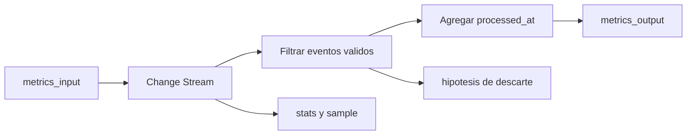

# Laboratorio 07: observabilidad y troubleshooting ASP

**Descripcion:** Ejecuta un processor con datos controlados y observa como cambian
sus señales cuando entran eventos validos, invalidos y pausas de entrada.

Aprende a interpretar `stats()`, `sample()`, estado del processor, salida en
Atlas y señales de DLQ/logs para diagnosticar fallos de Atlas Stream Processing.

Documentacion oficial relacionada:

- https://www.mongodb.com/docs/atlas/atlas-stream-processing/monitoring
- https://www.mongodb.com/docs/atlas/atlas-stream-processing/quickstart
- https://www.mongodb.com/docs/manual/reference/method/sp.processor.sample

## Objetivo

Entender un processor en operacion: comprobar si existe, si esta arrancado, si
recibe datos, si transforma correctamente, si escribe en el sink y donde mirar
cuando algo no cuadra.

## Conceptos ASP

- `sp.listStreamProcessors()` para confirmar existencia del processor;
- `sp.<processor>.stats()` para leer estado y actividad operacional;
- `sp.<processor>.sample()` para observar documentos procesados en vivo;
- comparacion entre fuente, muestra y sink persistido;
- filtros que descartan documentos sin ser errores del sistema;
- DLQ como evidencia de fallos procesables por el processor;
- logs y Atlas UI como siguiente nivel cuando `stats()` no basta.

## Flow sencillo



En una frase:

```text
metrics_input -> processor observable -> metrics_output -> diagnostico guiado
```

## Preparacion

Necesitas:

- un workspace ASP de pruebas;
- una conexion Atlas llamada `atlas_lab`;
- acceso al cluster Atlas con `mongosh`;
- las colecciones `playground.metrics_input` y `playground.metrics_output`.

Para trabajar con las colecciones del cluster Atlas, conecta con:

```bash
mongosh "$ATLAS_URI"
```

La conexión al workspace ASP es independiente y se realiza con su hostname.

`metrics_output` puede ser creada por `$merge` en la primera escritura.

## Paso 1: arrancar el processor sin trafico

En `mongosh` conectado al workspace ASP:

```javascript
load("[local-repository]/projects/07-metrics-observability/processor.js")
sp.listStreamProcessors()
sp.labMetricsObservability.start()
sp.labMetricsObservability.stats()
```

Primera lectura: el processor debe existir y estar arrancado. Si no hay eventos
nuevos, no esperes salida en `metrics_output`.

## Paso 2: generar datos controlados

En otra sesion `mongosh` conectada al cluster Atlas:

```javascript
load("[local-repository]/scripts/07-seed-metrics.js")
```

El seeder inserta seis eventos en `playground.metrics_input`: cuatro validos y
dos invalidos. Los invalidos no deben llegar a `metrics_output` porque el
processor exige `device_id` string y `value` numerico.

## Paso 3: observar señales del processor

En el workspace ASP:

```javascript
sp.labMetricsObservability.stats()
sp.labMetricsObservability.sample()
```

`stats()` ayuda a saber si el processor esta activo. `sample()` muestra documentos
que ya pasaron el pipeline; si no aparece nada, no asumas aun que el processor
esta roto.

## Paso 4: comparar fuente y sink

En el cluster Atlas:

```javascript
use playground

db.metrics_input.countDocuments()
db.metrics_output.countDocuments()
db.metrics_output.find().sort({ device_id: 1 }).pretty()
```

Resultado esperado:

- `metrics_input` contiene seis eventos;
- `metrics_output` contiene tres documentos, porque `device-001` se reemplaza
  con su valor mas reciente;
- `device-003` y el evento sin `device_id` no aparecen en la salida;
- cada salida tiene `processed_at` y `lab: "metrics-observability"`.

## Paso 5: diagnostico guiado

| Sintoma | Hipotesis | Donde mirar |
|---|---|---|
| No existe el processor | No se ejecuto `load()` o fallo la creacion | `sp.listStreamProcessors()` |
| Existe pero no procesa | No esta arrancado o no llegan eventos nuevos | `stats()`, inserciones recientes |
| `sample()` no muestra datos | No pasaron eventos por el pipeline o ya no hay muestra disponible | `stats()`, sink Atlas |
| Hay input pero poca salida | Filtros descartan documentos invalidos | comparar `metrics_input` y `metrics_output` |
| El sink no crece | Problema de conexion, permisos o `$merge` | `atlas_lab`, logs, Atlas UI |
| Aparecen errores | Fallo de operador o documento incompatible | DLQ, logs, `errInfo.reason` |
| La salida cambia de valor | `$merge` reemplaza por `device_id` | `metrics_output.find()` |

## Ideas clave de troubleshooting

1. Empieza por el estado: confirma que el workspace, la conexion y el processor
   existen antes de mirar datos.
2. Separa fuente, pipeline y sink. Un fallo en salida no siempre significa que
   la fuente no emita.
3. Genera eventos nuevos despues de arrancar el processor cuando uses Change
   Streams.
4. Usa `sample()` para ver documentos que atraviesan el pipeline, no como unica
   prueba de persistencia.
5. Compara conteos de entrada y salida para detectar filtros, reemplazos o
   perdidas esperadas.
6. Trata la DLQ como evidencia estructurada: revisa `processorName`,
   `operatorName`, `errInfo.reason`, `doc` y `_stream_meta`.
7. No cambies varias cosas a la vez: formula una hipotesis, ejecuta una prueba
   barata y valida si el resultado la confirma.

## Preguntas de comprobacion

Al terminar, la persona deberia poder responder:

- Que comando confirma que el processor existe?
- Que diferencia hay entre `stats()` y `sample()`?
- Por que hay menos documentos en `metrics_output` que en `metrics_input`?
- Que campo indica que el processor agrego informacion nueva?
- Donde mirarias si `$merge` no escribe en Atlas?
- Cuando tiene sentido revisar DLQ?

## Limpieza

En el workspace ASP:

```javascript
sp.labMetricsObservability.stop()
sp.labMetricsObservability.drop()
sp.listStreamProcessors()
```

En el cluster Atlas:

```javascript
use playground
db.metrics_input.drop()
db.metrics_output.drop()
```

Este laboratorio no reemplaza la observabilidad de Atlas UI ni integraciones
como Datadog u OpenTelemetry. Su objetivo es construir el habito de diagnostico
con señales basicas y datos controlados antes de pasar a sistemas externos.
