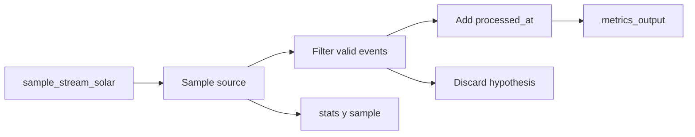

# Lab 07: ASP Observability and Troubleshooting

**Overview:** Run a processor against `sample_stream_solar` and monitor its
state, the documents flowing through the pipeline, and the Atlas sink.

Learn to interpret `stats()`, `sample()`, processor state, Atlas output, and
DLQ/log signals to diagnose Atlas Stream Processing issues.

Documentacion oficial relacionada:

- https://www.mongodb.com/docs/atlas/atlas-stream-processing/monitoring
- https://www.mongodb.com/docs/atlas/atlas-stream-processing/quickstart
- https://www.mongodb.com/docs/manual/reference/method/sp.processor.sample

## Objective

Understand a processor in operation: confirm that it exists and is running,
receives data, transforms events correctly, and writes to the sink. Learn where
to investigate when results do not match expectations.

This lab establishes the baseline for Lab 08. It does not compare workers or
measure performance; first, it distinguishes health, data flow, output, and
diagnostic signals.

## ASP Concepts

- `sp.listStreamProcessors()` para confirmar existencia del processor;
- `sp.<processor>.stats()` para leer estado y actividad operacional;
- `sp.<processor>.sample()` to inspect documents processed in real time;
- comparison of source events, samples, and persisted sink output;
- filters that discard Sample events without the expected fields;
- the DLQ as evidence of processor-handled failures;
- logs and the Atlas UI as the next diagnostic level when `stats()` is insufficient.

## Data Flow



In summary:

```text
sample_stream_solar -> observable processor -> metrics_output -> guided diagnosis
```

## Prerequisites

Before continuing, run `atlas auth login` in the terminal and verify the
session with `atlas auth whoami`. If the session has expired, run
`atlas auth login` again.

Prepare the shared environment using the [Lab 00 manual](../00-assessment/MANUAL.md).
This lab does not create clusters, users, or workspaces.

Before using `ATLAS_URI`, run `./scripts/validate-atlas-connection.sh` from the
project root to detect an outdated hostname.

You will need:

- a test ASP workspace;
- an Atlas connection named `atlas_lab`;
- `mongosh` access to the Atlas cluster;
- the `sample_stream_solar` Sample connection;
- the `playground.metrics_output` collection.

Before loading the pipeline, run this preflight in the ASP workspace:

```javascript
sp.listConnections()
try { sp.labMetricsObservability.stop() } catch (error) {}
try { sp.labMetricsObservability.drop() } catch (error) {}
```

In the Atlas cluster, clear the lab sink to avoid mixing results from previous
runs:

```javascript
use playground
db.metrics_output.drop()
```

If `sample_stream_solar` or `atlas_lab` is missing, or the workspace is not
operational, stop and complete [Lab 00](../00-assessment/MANUAL.md).

To work with collections in the Atlas cluster, connect with:

```bash
mongosh "$ATLAS_URI"
```

The ASP workspace uses a separate connection through its hostname.

`$merge` may create `metrics_output` on the first write.

## Step 1: Start the Processor

In `mongosh` connected to the ASP workspace:

```javascript
load("[local-repository]/projects/07-metrics-observability/processor.js")
sp.listStreamProcessors()
sp.labMetricsObservability.start()
sp.labMetricsObservability.stats()
```

First, confirm that the processor exists and is running. Sample generates
events independently; this lab does not control their rate or volume.

## Step 2: Inspect Processor Signals

In the ASP workspace:

```javascript
sp.labMetricsObservability.stats()
sp.labMetricsObservability.sample()
```

`stats()` indicates whether the processor is active. `sample()` displays
documents that have passed through the pipeline; if it returns nothing, do not
assume the processor is faulty yet.

## Step 3: Compare the Source and Sink

In the Atlas cluster:

```javascript
use playground

db.metrics_output.countDocuments()
db.metrics_output.find().sort({ device_id: 1 }).pretty()
```

Expected results:

- `metrics_output` contains at most one document per `device_id`;
- a new sample from the same device replaces its previous document;
- each valid output contains `value`, `observed_at`, `processed_at`, and
   `lab: "metrics-observability"`;
- the exact count and content depend on the events generated by Sample.

Classify observations into three categories:

| Signal type | Examples | Question answered |
|---|---|---|
| Health | `stats()` state, errors, processor existence | Is the processor operational? |
| Flow | `sample()`, sink count, and `stats()` activity | Are events flowing through the pipeline? |
| Output | `metrics_output` fields and replacements by `device_id` | Is the output correct? |

## Step 5: Guided Diagnosis

| Symptom | Hypothesis | Where to check |
|---|---|---|
| Processor is missing | `load()` was not run or creation failed | `sp.listStreamProcessors()` |
| Processor exists but does not process data | It is not running or no new events are arriving | `stats()`, recent inserts |
| `sample()` returns no data | No events passed through the pipeline or no sample is currently available | `stats()`, Atlas sink |
| Activity is visible but output is low | The filter discards samples without the expected fields | Compare `sample()` with `metrics_output` |
| Sink is not growing | Connection, permissions, or `$merge` issue | `atlas_lab`, logs, Atlas UI |
| Errors appear | Operator failure or incompatible document | DLQ, logs, `errInfo.reason` |
| Output values change | `$merge` replaces documents by `device_id` | `metrics_output.find()` |

## Troubleshooting Guidelines

1. Start with processor state: confirm that the workspace, connection, and
   processor exist before inspecting data.
2. Check the source, pipeline, and sink separately. Missing output does not
   necessarily mean the source is inactive.
3. Remember that Sample generates events. This lab cannot insert a controlled
   batch or guarantee a specific event count.
4. Use `sample()` to inspect documents flowing through the pipeline, not as the
   only evidence of persistence.
5. Compare `sample()` with the sink to identify expected filtering or replacement.
6. Treat the DLQ as structured evidence: inspect `processorName`,
   `operatorName`, `errInfo.reason`, `doc`, and `_stream_meta`.
7. Change one variable at a time. Form a hypothesis, run a low-cost check, and
   determine whether the result supports it.

## ASP Metrics to Review

Interpret the `stats()` signals in this order:

| Metric | Description | Expected signal |
|---|---|---|
| `state` | Processor health | `STARTED` |
| `inputMessageCount` | Messages received from the source | Increases as events arrive |
| `outputMessageCount` | Messages that complete the pipeline | Increases alongside sink output |
| `dlqMessageCount` | Messages that failed | `0` for a successful run |
| `lastMessageIn` | Time of the most recent event received | Advances as new events arrive |
| `lastCheckpointSave` | Persisted source progress | Advances after processing |
| `throttle.throttleEvents` | Events limited by capacity | `0` or an explained increase |
| `memoryUsageBytes` | Memory used by the processor | Review the trend, not a single value |

Do not treat a `STARTED` processor as proof of a healthy pipeline: it may be
active while sending every event to the DLQ. Always review input, output, DLQ,
and sink data together.

## Baseline Criteria

Before moving to Lab 08, record these results from a clean run:

```text
processor: labMetricsObservability
source: sample_stream_solar
sink key: device_id
processor state: STARTED
unexpected errors: 0
```

This baseline is not a benchmark and does not require a fixed document count.
It provides a reference for distinguishing configuration issues from behavior
changes introduced in Lab 08.

## Review Questions

After completing the lab, participants should be able to answer:

- Which command confirms that the processor exists?
- What is the difference between `stats()` and `sample()`?
- Why does `metrics_output` retain at most one document per device?
- Which field indicates that the processor added new information?
- Where should you investigate if `$merge` does not write to Atlas?
- When should you review the DLQ?

## Cleanup

In the ASP workspace:

```javascript
sp.labMetricsObservability.stop()
sp.labMetricsObservability.drop()
sp.listStreamProcessors()
```

In the Atlas cluster:

```javascript
use playground
db.metrics_output.drop()
```

This lab does not replace Atlas UI observability or integrations such as
Datadog or OpenTelemetry. Its purpose is to establish a diagnostic practice
using basic signals from a Sample source before progressing to controlled data
and external systems.
