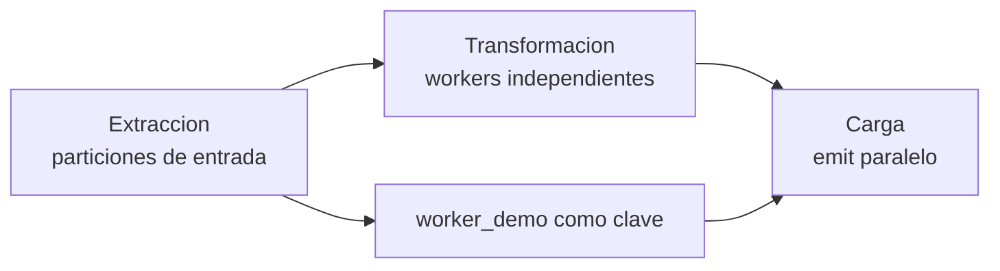

# Laboratorio 08: paralelismo en las tres fases del ETL

**Descripcion:** Compara una salida serial con una salida paralela y aprende a
ubicar el paralelismo en extraccion, transformacion y carga sin confundir una
mayor cantidad de workers con una mayor velocidad garantizada.

## Objetivo

Al terminar, deberias poder:

- identificar donde se puede paralelizar cada fase de un flujo ETL;
- distinguir particionamiento de datos, concurrencia de transformaciones y
  paralelismo del sink;
- explicar por que una clave de particion estable es necesaria para conservar
  orden por entidad;
- comparar una carga con `parallelism: 1` y otra con `parallelism: 2`.

## Idea principal



Las tres fases pueden aprovechar paralelismo, pero no se configuran igual:

| Fase ETL | Que se paraleliza | Como se observa en este laboratorio |
|---|---|---|
| Extraccion | Lectura de particiones o shards independientes | La fuente Change Stream limita este ejemplo; `worker_demo` solo modela una clave de afinidad |
| Transformacion | Aplicacion de filtros y calculos sobre eventos independientes | Cada evento recibe `value_squared` y `transformed_at` |
| Carga | Escrituras concurrentes hacia el sink | `$emit` usa `parallelism: 1` frente a `parallelism: 2` |

En Atlas Stream Processing, `$emit.parallelism` es la configuracion visible de
este ejemplo. La extraccion y la transformacion no reciben aqui un parametro
`parallelism` independiente. Su rendimiento depende de la fuente, las
particiones disponibles y la capacidad del workspace; `worker_demo` no crea
particiones ni identifica el worker fisico.

## Preparacion

Necesitas:

- un Stream Processing Workspace de pruebas;
- una conexion Atlas llamada `atlas_lab`;
- acceso al cluster Atlas con `mongosh`;
- las colecciones `playground.parallelism_input`,
  `playground.parallelism_serial_output` y
  `playground.parallelism_parallel_output`.

En una terminal del proyecto, carga la configuracion local y comprueba el
acceso de Atlas CLI:

```bash
cd [local-repository]
source .env
atlas whoami
```

`[redacted]` es la cuenta de Atlas CLI. `stream[redacted]` es el usuario de base
de datos cuya contraseña ya esta incluida en `ATLAS_URI`; no son la misma
identidad. El usuario `stream[redacted]` necesita al menos `readWrite` sobre
`playground`, y `atlas_lab` debe estar en estado `READY` en el workspace ASP.

Para insertar y consultar documentos en el cluster Atlas, conecta con:

```bash
mongosh "$ATLAS_URI"
```

La conexión al workspace ASP usa su hostname y no `ATLAS_URI`.

La coleccion de entrada debe recibir documentos nuevos despues de arrancar los
processors. Los documentos anteriores al arranque no se reprocesan
automaticamente.

## Paso 1: crear y arrancar los processors

En `mongosh`, conectado al endpoint del workspace:

Si estas repitiendo el laboratorio y los processors ya existen, detenlos y
eliminalos antes de cargar una definicion nueva:

```javascript
sp.labParallelismSerial.stop()
sp.labParallelismWorkers.stop()
sp.labParallelismSerial.drop()
sp.labParallelismWorkers.drop()
```

Carga el processor desde la ruta absoluta:

```javascript
load("[local-repository]/projects/08-parallelism/processor.js")
```

Comprueba que existen y arráncalos:

```javascript
sp.listStreamProcessors()
sp.labParallelismSerial.start()
sp.labParallelismWorkers.start()
sp.labParallelismSerial.stats()
sp.labParallelismWorkers.stats()
```

`stats()` debe mostrar `state: "STARTED"`, sin errores, antes de insertar datos.

Para una comparación limpia, vuelve a la sesión Atlas y elimina los datos de
ejecuciones anteriores antes de insertar el lote de prueba:

```javascript
use playground
db.parallelism_input.deleteMany({})
db.parallelism_serial_output.deleteMany({})
db.parallelism_parallel_output.deleteMany({})
```

Los dos processors leen la misma forma de evento y ejecutan la misma
transformacion. La unica diferencia experimental es la capacidad de carga:

- `labParallelismSerial` escribe con un worker de emit;
- `labParallelismWorkers` escribe con dos workers de emit;
- ambos conservan `worker_demo` en el documento para comparar los resultados.

En este sink Atlas, `parallelism` controla los threads internos de escritura.
No se configura `partitionBy` en `$emit` para una colección Atlas; por eso
`worker_demo` no garantiza afinidad de escritura ni orden por partición.

## Paso 2: comprobar la transformacion

En la sesion `mongosh` conectada al cluster Atlas, inserta eventos nuevos:

```javascript
use playground

db.parallelism_input.insertMany([
  { sequence: 1, worker_demo: "partition-a", value: 2, observed_at: new Date() },
  { sequence: 2, worker_demo: "partition-b", value: 3, observed_at: new Date() },
  { sequence: 3, worker_demo: "partition-a", value: 4, observed_at: new Date() },
  { sequence: 4, worker_demo: "partition-b", value: 5, observed_at: new Date() }
])
```

Los eventos validos necesitan `sequence` numerico, `worker_demo` string, `value`
numerico y `observed_at` de tipo fecha. Despues de insertarlos, en la sesion
ASP ejecuta:

```javascript
sp.labParallelismSerial.sample()
sp.labParallelismWorkers.sample()
```

Cada documento procesado debe incluir:

```javascript
{
  sequence: 1,
  worker_demo: "partition-a",
  value: 2,
  value_squared: 4,
  etl_stage: "transform"
}
```

`value_squared` demuestra que el evento atraveso la fase de transformacion;
`worker_demo` permite razonar sobre como se agrupan los eventos; no es una
medicion del worker fisico que ejecuto cada documento.

## Paso 3: comparar la carga

En el cluster Atlas:

```javascript
use playground

db.parallelism_serial_output.countDocuments()
db.parallelism_parallel_output.countDocuments()
db.parallelism_parallel_output.find().sort({ worker_demo: 1, sequence: 1 }).pretty()
```

Compara tambien los documentos por `sequence`, no solo los contadores:

```javascript
db.parallelism_serial_output.find({}, { _id: 0, sequence: 1, value_squared: 1 }).sort({ sequence: 1 }).toArray()
db.parallelism_parallel_output.find({}, { _id: 0, sequence: 1, value_squared: 1 }).sort({ sequence: 1 }).toArray()
```

Los dos sinks deben contener el mismo numero de eventos validos y los mismos
valores transformados. La salida paralela no tiene por que terminar antes con
un lote pequeño: el beneficio aparece cuando hay suficiente volumen, trabajo
por evento y capacidad disponible.

Comprueba también que no se crearon documentos invalidos:

```javascript
db.parallelism_serial_output.countDocuments({ _id: null })
db.parallelism_parallel_output.countDocuments({ _id: null })
```

Ambos resultados deben ser `0`. Las colecciones de salida conservan los
eventos de ejecuciones anteriores, así que para una comparación limpia
elimínalas antes de volver a ejecutar el experimento.

## Experimento guiado

1. Inserta 100 o mas eventos repartidos entre `partition-a` y `partition-b`.
2. Observa `stats()` en ambos processors antes y despues de la insercion.
3. Compara los contadores de los dos sinks.
4. Cambia temporalmente `parallelism: 2` a `parallelism: 1` y repite la prueba.
5. Pregunta: que ocurriria si dos eventos de la misma entidad pudieran escribirse
  en paralelo sin una garantía de orden del sink?

## Que significa paralelizar cada fase

### Extraccion

La fuente debe poder dividir el flujo en particiones independientes. En una
fuente particionada, aumentar consumidores solo ayuda si existen particiones
suficientes y la clave reparte el trafico. Este laboratorio usa un Change Stream
de MongoDB, por lo que no demuestra particiones de extraccion configurables;
`worker_demo` solo permite hablar de afinidad de datos.

### Transformacion

Los filtros y calculos por evento son buenos candidatos cuando no dependen de
un estado global. Los joins, ventanas y agregaciones requieren mas cuidado:
hay que preservar la afinidad de particion y considerar el estado compartido.

### Carga

El sink puede escribir con varios workers usando `$emit.parallelism`. Esto
mejora el throughput cuando el destino, la red y la conexion soportan escrituras
concurrentes. No elimina limites de cuota ni garantiza orden global.

## Preguntas de comprobacion

- Que parte del laboratorio representa la clave de particion de entrada?
- Por que `value_squared` prueba la transformacion pero no mide el numero de workers?
- Que propiedad cambia entre las dos salidas?
- Por que dos sinks pueden tener la misma cantidad de documentos aunque uno use
  paralelismo?
- En que casos el paralelismo puede empeorar el resultado o romper el orden?
- Que capacidad del destino debes comprobar antes de aumentar `parallelism`?

## Limpieza

En el workspace ASP:

```javascript
sp.labParallelismSerial.stop()
sp.labParallelismWorkers.stop()
sp.labParallelismSerial.drop()
sp.labParallelismWorkers.drop()
```

En el cluster Atlas:

```javascript
use playground
db.parallelism_input.drop()
db.parallelism_serial_output.drop()
db.parallelism_parallel_output.drop()
```

## Documentacion relacionada

- https://www.mongodb.com/docs/atlas/atlas-stream-processing/sp-agg-emit/
- https://www.mongodb.com/docs/atlas/atlas-stream-processing/sp-operators/
- https://www.mongodb.com/docs/atlas/atlas-stream-processing/monitoring/
