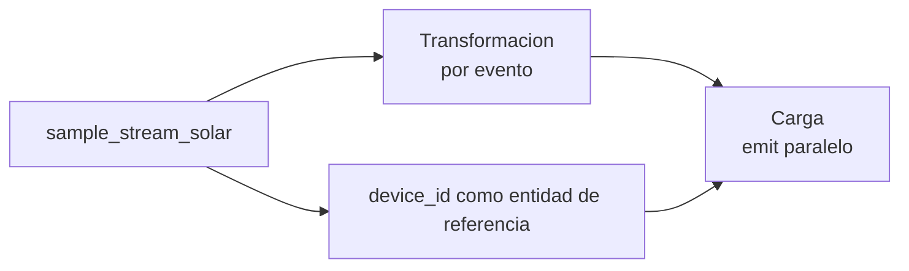

# Laboratorio 08: paralelismo en las tres fases del ETL

**Descripcion:** Usa la observabilidad aprendida en el laboratorio 07 para
comparar una salida serial con salidas paralelas. No es un benchmark oficial:
es un experimento controlado sobre capacidad, resultados y riesgos de orden.

Completa primero [laboratorio 07](../07-metrics-observability), que proporciona
la linea base de estado, `stats()`, `sample()` y validacion del sink.

El procedimiento operativo completo del modo reproducible esta en
[MANUAL.md](MANUAL.md).

El laboratorio ofrece dos modos:

| Modo | Processor | Proposito |
|---|---|---|
| Introductorio | `processor.js` | Observar Sample y comparar la carga sin preparar datos. |
| Reproducible | `processor-change-stream.js` | Comparar los mismos eventos con Change Streams. |

Empieza con el modo Sample. Usa el modo Change Stream cuando quieras controlar
el lote, repetir una ejecucion y estudiar secuencias, actualizaciones y orden.
No cargues los dos modos al mismo tiempo porque crean processors con los mismos
nombres.

## Objetivo

Al terminar, deberias poder:

- identificar donde se puede paralelizar cada fase de un flujo ETL;
- distinguir particionamiento de datos, concurrencia de transformaciones y
  paralelismo del sink;
- explicar por que una clave de particion estable es necesaria para conservar
  orden por entidad;
- comparar una carga con `parallelism: 1` y otra con `parallelism: 2`;
- repetir el mismo experimento con varios volumenes sin mezclar ejecuciones;
- distinguir rendimiento observado de correccion funcional.

## Idea principal



Las tres fases pueden aprovechar paralelismo, pero no se configuran igual:

| Fase ETL | Que se paraleliza | Como se observa en este laboratorio |
|---|---|---|
| Extraccion | Lectura de eventos generados por Sample | Sample no ofrece aqui particiones ni volumen controlado |
| Transformacion | Aplicacion de filtros y calculos sobre eventos independientes | Cada evento recibe `value_squared` y `etl_stage` |
| Carga | Escrituras concurrentes hacia el sink | `$emit` usa `parallelism: 1` frente a `parallelism: 2` |

En Atlas Stream Processing, `$emit.parallelism` es la configuracion visible de
este ejemplo. La extraccion y la transformacion no reciben aqui un parametro
`parallelism` independiente. Su rendimiento depende de la fuente, las
particiones disponibles y la capacidad del workspace; `device_id` no crea
particiones ni identifica el worker fisico.

## Preparacion

Antes de continuar, ejecuta `atlas auth login` desde la consola y confirma la
sesión con `atlas auth whoami`. Si la sesión ha caducado, vuelve a ejecutar
`atlas auth login`.

Prepara primero el entorno común con el [laboratorio 00](../00-assessment/MANUAL.md).
Este laboratorio no crea clusters, usuarios ni workspaces.

Antes de usar `ATLAS_URI`, ejecuta `./scripts/validate-atlas-connection.sh`
desde la raíz del proyecto para detectar un hostname antiguo.

Para el modo Change Stream, sigue el [manual operativo](MANUAL.md): detiene
processors anteriores y limpia solo las colecciones de este laboratorio antes
de insertar documentos nuevos.

Necesitas:

- un Stream Processing Workspace de pruebas;
- una conexion Atlas llamada `atlas_lab`;
- acceso al cluster Atlas con `mongosh`;
- la conexion Sample `sample_stream_solar` para el modo introductorio;
- la coleccion `playground.parallelism_input` para el modo Change Stream;
- las colecciones `playground.parallelism_serial_output` y
  `playground.parallelism_parallel_output`;
- las colecciones DLQ `playground.parallelism_serial_dlq` y
  `playground.parallelism_parallel_dlq`.

En el modo Sample, los documentos transformados usan estos campos de
referencia:

| Campo | Funcion |
|---|---|
| `device_id` | Se usa como entidad de referencia derivada del evento Sample. |
| `observed_at` | Permite conservar la fecha normalizada del evento. |
| `source` | Confirma que la salida procede de `sample_stream_solar`. |

En el modo Change Stream se añaden `run_id`, `entity_id`, `sequence`,
`partition_key` y `change_version` para controlar el experimento.

En una terminal del proyecto, carga la configuracion local y comprueba el
acceso de Atlas CLI:

```bash
cd [local-repository]
source .env
atlas whoami
```

`[redacted]` es la cuenta de Atlas CLI. `stream[redacted]` es el usuario de base
de datos cuya contraseña ya esta incluida en `ATLAS_URI`; no son la misma
identidad. El usuario `stream[redacted]` necesita al menos `readWrite` sobre
`playground`, y `atlas_lab` debe estar en estado `READY` en el workspace ASP.

Para insertar y consultar documentos en el cluster Atlas, conecta con:

```bash
mongosh "$ATLAS_URI"
```

La conexión al workspace ASP usa su hostname y no `ATLAS_URI`.

En el modo Sample, la fuente genera los documentos de entrada. En el modo
Change Stream, el seeder escribe en `parallelism_input` despues de arrancar
ambos processors.

## Fase 1: establecer la linea base

El objetivo es comprobar que el flujo funciona antes de cambiar el
paralelismo. Limpia las colecciones, crea los processors y observa su estado.

```javascript
use playground
db.parallelism_serial_output.deleteMany({})
db.parallelism_parallel_output.deleteMany({})
```

Despues continua con el paso siguiente y usa `parallelism: 1` como referencia.

## Paso 1: crear y arrancar los processors

En `mongosh`, conectado al endpoint del workspace:

Si estas repitiendo el laboratorio y los processors ya existen, detenlos y
eliminalos antes de cargar una definicion nueva:

```javascript
sp.labParallelismSerial.stop()
sp.labParallelismWorkers.stop()
sp.labParallelismSerial.drop()
sp.labParallelismWorkers.drop()
```

Carga el processor desde la ruta absoluta:

```javascript
load("[local-repository]/projects/08-parallelism/processor.js")
```

Comprueba que existen y arráncalos:

```javascript
sp.listStreamProcessors()
sp.labParallelismSerial.start()
sp.labParallelismWorkers.start()
sp.labParallelismSerial.stats()
sp.labParallelismWorkers.stats()
```

`stats()` debe mostrar `state: "STARTED"`, sin errores, antes de insertar datos.

Los dos processors leen la misma forma de evento y ejecutan la misma
transformacion. La unica diferencia experimental es la capacidad de carga:

- `labParallelismSerial` escribe con un worker de emit;
- `labParallelismWorkers` escribe con dos workers de emit;
- ambos conservan `device_id`, `observed_at` y `source` para comparar los
  resultados.

En este sink Atlas, `parallelism` controla los threads internos de escritura.
No se configura `partitionBy` en `$emit` para una colección Atlas. `device_id`
permite agrupar la salida para observarla, pero no garantiza afinidad de
escritura ni orden por partición.

## Fase 2: comparar serial y paralelo

### Paso 2: observar la misma fuente

No insertes documentos manualmente. Los dos processors reciben eventos de
`sample_stream_solar` mientras estan arrancados. En la sesion ASP ejecuta:

```javascript
sp.labParallelismSerial.sample()
sp.labParallelismWorkers.sample()
```

Cada documento procesado debe incluir:

```javascript
{
  device_id: "device_8",
  entity_id: "device_8",
  value: 252,
  observed_at: ISODate("2024-08-12T21:41:01.788Z"),
  value_squared: 63504,
  etl_stage: "transform",
  source: "sample_stream_solar"
}
```

`value_squared` demuestra que el evento atraveso la fase de transformacion;
`device_id` sirve como entidad de referencia y `source` confirma el origen.
Ninguno de esos campos identifica el worker fisico ni crea una particion real.

## Paso 3: comparar la carga

En el cluster Atlas:

```javascript
use playground

db.parallelism_serial_output.countDocuments()
db.parallelism_parallel_output.countDocuments()
db.parallelism_parallel_output.find().sort({ device_id: 1, observed_at: 1 }).pretty()
```

Compara tambien los documentos por `device_id` y `observed_at`, no solo los
contadores:

```javascript
db.parallelism_serial_output.find({}, { _id: 0, device_id: 1, value: 1, value_squared: 1, observed_at: 1 }).sort({ device_id: 1, observed_at: 1 }).toArray()
db.parallelism_parallel_output.find({}, { _id: 0, device_id: 1, value: 1, value_squared: 1, observed_at: 1 }).sort({ device_id: 1, observed_at: 1 }).toArray()
```

Las salidas deben contener documentos con la misma forma transformada. No
exijas el mismo numero exacto ni una misma ventana temporal: Sample genera el
flujo y los dos processors pueden observar momentos distintos de esa fuente.
La salida paralela no tiene por que terminar antes; el beneficio aparece solo
si hay suficiente trabajo y capacidad disponible.

Comprueba también que no se crearon documentos invalidos:

```javascript
db.parallelism_serial_output.countDocuments({ _id: null })
db.parallelism_parallel_output.countDocuments({ _id: null })
```

Ambos resultados deben ser `0`. Las colecciones de salida conservan eventos de
ejecuciones anteriores, por lo que conviene vaciarlas antes de cada observacion.

## Modo B: experimento reproducible con Change Stream

Este modo usa la misma colección de entrada para los dos processors. Como ambos
se conectan antes de insertar datos, cada uno recibe el mismo lote de cambios.

### Preparar la colección y los sinks

En el cluster Atlas:

```javascript
use playground
db.parallelism_input.deleteMany({})
db.parallelism_serial_output.deleteMany({})
db.parallelism_parallel_output.deleteMany({})
db.parallelism_serial_dlq.deleteMany({})
db.parallelism_parallel_dlq.deleteMany({})
```

En el workspace ASP, si ya ejecutaste el modo Sample, detén y elimina sus
processors antes de cargar el modo Change Stream:

```javascript
sp.labParallelismSerial.stop()
sp.labParallelismWorkers.stop()
sp.labParallelismSerial.drop()
sp.labParallelismWorkers.drop()
load("[local-repository]/projects/08-parallelism/processor-change-stream.js")
sp.labParallelismSerial.start()
sp.labParallelismWorkers.start()
sp.labParallelismSerial.stats()
sp.labParallelismWorkers.stats()
```

Los dos processors deben mostrar `state: "STARTED"` antes de insertar datos.

Cada processor tiene un DLQ Atlas independiente:

| Processor | Namespace DLQ |
|---|---|
| `labParallelismSerial` | `playground.parallelism_serial_dlq` |
| `labParallelismWorkers` | `playground.parallelism_parallel_dlq` |

Si las colecciones DLQ no existen, créalas antes de arrancar los processors:

```javascript
use playground
db.createCollection("parallelism_serial_dlq")
db.createCollection("parallelism_parallel_dlq")
```

### Insertar el lote controlado

En otra sesión `mongosh`, conectada al cluster Atlas, ejecuta:

```javascript
load("[local-repository]/scripts/08-seed-parallelism.js")
```

El seeder inserta 100 eventos para `run-001` y después actualiza un evento de
cada entidad. Con `fullDocument: "updateLookup"`, los processors reciben los
documentos completos también para esos cambios.

Comprueba el resultado:

```javascript
use playground

db.parallelism_serial_output.countDocuments({ run_id: "run-001" })
db.parallelism_parallel_output.countDocuments({ run_id: "run-001" })
db.parallelism_parallel_output.find({ run_id: "run-001" }).sort({ entity_id: 1, sequence: 1, change_version: 1 }).toArray()
```

La expectativa educativa es observar 104 cambios por sink: 100 inserciones y
4 actualizaciones. La comparación debe revisar también `value`,
`value_squared` y `change_version`, no solamente el contador.

Comprueba también los DLQ:

```javascript
db.parallelism_serial_dlq.countDocuments()
db.parallelism_parallel_dlq.countDocuments()
db.parallelism_serial_dlq.findOne()
db.parallelism_parallel_dlq.findOne()
```

En una ejecución correcta, ambos contadores deben ser `0`. Si hay errores,
revisa `errInfo.reason`, `operatorName`, `doc` y `_stream_meta` en el documento
DLQ correspondiente.

Este modo permite estudiar de forma controlada duplicados, actualizaciones y
secuencias. No convierte `$emit.parallelism` en una garantía de orden: la
corrección del resultado y el orden deben comprobarse por separado.

## Fase 3: observar durante intervalos iguales en modo Sample

Sample no permite elegir lotes de 100, 1.000 o 5.000 eventos. Para una
comparacion educativa, observa ambos processors durante intervalos iguales y
anota el momento de inicio y fin:

| Medida | Como obtenerla |
|---|---|
| Eventos observados | Diferencia de conteos del sink durante el intervalo. |
| Eventos de salida | Conteo de cada sink al final del intervalo. |
| Errores | `stats()` y DLQ/logs si existen. |
| Duracion | Hora de inicio y fin del intervalo. |
| Throughput aproximado | Eventos observados dividido por duracion. |

Compara solo tendencias dentro del mismo workspace. No presentes el resultado
como una garantia de rendimiento para otros tiers, regiones o destinos.

Para el modo Change Stream, la comparación reproducible de volumen está en el
[manual operativo](MANUAL.md): ejecuta los lotes `run-100`, `run-1000` y
`run-5000` con `SEED_EVENT_COUNT` y `SEED_RUN_ID`, y compara ambas salidas por
`run_id`.

En cada tamaño registra en `stats()` `state`, `inputMessageCount`,
`outputMessageCount`, `dlqMessageCount`, `lastMessageIn`,
`lastCheckpointSave`, `throttle.throttleEvents` y `memoryUsageBytes`. La señal
de éxito es `STARTED`, entrada y salida crecientes, DLQ en cero y checkpoints
avanzando. Solo después compara throughput entre `parallelism: 1` y `2`.

Nota de esta ejecución educativa: 100 y 1.000 eventos fueron suficientes para
validar resultados, pero solo 5.000 eventos mostraron una diferencia visible de
drenaje entre `parallelism: 1` y `parallelism: 2`. Con 5.000, el processor
paralelo alcanzó antes el total esperado, mientras el serial aún procesaba
eventos. El resultado depende de la capacidad disponible y no constituye un
benchmark universal.

El seeder también imprime marcas locales `startedAt`, `finishedAt` y
`seedDurationMs`. Combínalas con el momento local en que cada sink alcanza su
contador esperado para separar el tiempo de escritura de entrada del tiempo de
vaciar el pipeline. Son mediciones educativas, no latencia oficial de Atlas.

## Fase 4: limites del experimento

Con Sample puedes comprobar:

- que ambos pipelines realizan la misma transformacion;
- que `parallelism: 1` y `parallelism: 2` escriben en sinks separados;
- que el estado, `stats()` y `sample()` siguen siendo observables;
- que el destino puede convertirse en el cuello de botella.

En modo Sample no puedes demostrar de forma controlada eventos perdidos,
duplicados, secuencias fuera de orden, reintentos o idempotencia. Esos temas sí
se pueden estudiar en el modo Change Stream con `run_id`, `sequence` y
`change_version`, siempre comprobando los resultados por entidad.

## Guia de diagnostico

| Sintoma | Hipotesis inicial | Comprobacion barata |
|---|---|---|
| No hay salida | Processor detenido o conexion incorrecta | `stats()` y estado `STARTED` |
| Menos salida | Sample emite a otro ritmo o el filtro descarta un evento | Comparar `sample()` y conteos del sink |
| Mismo tiempo con 1 y 2 workers | Lote pequeno o sink limitante | Repetir con 1.000 eventos |
| Mas errores con 2 workers | Capacidad o limites del destino | Revisar `stats()` y logs |
| Duplicados | Observacion en momentos distintos o reintentos del sink | Comparar documentos por `device_id` y `observed_at` |
| Orden distinto | Sample no ofrece una secuencia controlada | No concluir orden por entidad con este lab |

## Que significa paralelizar cada fase

### Extraccion

La fuente debe poder dividir el flujo en particiones independientes. En una
fuente particionada, aumentar consumidores solo ayuda si existen particiones
suficientes y la clave reparte el trafico. `sample_stream_solar` no demuestra
particiones de extraccion configurables; `device_id` solo permite agrupar la
salida para observarla.

### Transformacion

Los filtros y calculos por evento son buenos candidatos cuando no dependen de
un estado global. Los joins, ventanas y agregaciones requieren mas cuidado:
hay que preservar la afinidad de particion y considerar el estado compartido.

### Carga

El sink puede escribir con varios workers usando `$emit.parallelism`. Esto
mejora el throughput cuando el destino, la red y la conexion soportan escrituras
concurrentes. No elimina limites de cuota ni garantiza orden global.

## Preguntas de comprobacion

- Que campo de Sample usamos como entidad de referencia?
- Por que `value_squared` prueba la transformacion pero no mide el numero de workers?
- Que propiedad cambia entre las dos salidas?
- Por que dos sinks pueden tener cantidades distintas aunque lean la misma
  fuente Sample?
- Que afirmaciones sobre orden no podemos hacer con Sample?
- Que capacidad del destino debes comprobar antes de aumentar `parallelism`?

## Limpieza

En el workspace ASP:

```javascript
sp.labParallelismSerial.stop()
sp.labParallelismWorkers.stop()
sp.labParallelismSerial.drop()
sp.labParallelismWorkers.drop()
```

En el cluster Atlas:

```javascript
use playground
db.parallelism_serial_output.drop()
db.parallelism_parallel_output.drop()
db.parallelism_serial_dlq.drop()
db.parallelism_parallel_dlq.drop()
```

## Documentacion relacionada

- https://www.mongodb.com/docs/atlas/atlas-stream-processing/sp-agg-emit/
- https://www.mongodb.com/docs/atlas/atlas-stream-processing/sp-operators/
- https://www.mongodb.com/docs/atlas/atlas-stream-processing/monitoring/
