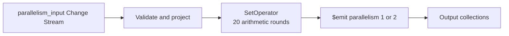

# Lab 08: Parallelism Across the Three ETL Stages

**Overview:** Apply the observability techniques from Lab 07 to compare serial
and parallel outputs. This is not an official benchmark; it is a controlled
experiment focused on capacity, results, and ordering risks.

Complete [Lab 07](../07-metrics-observability) first. It establishes a baseline
for processor state, `stats()`, `sample()`, and sink validation. The primary
exercise in this lab uses a Change Stream and a more computationally intensive
transformation to observe the `SetOperator` and the sink.

The complete procedure for the reproducible mode is in the
[operations manual](MANUAL.md).

This lab provides two modes:

| Mode | Processor | Purpose |
|---|---|---|
| Primary | `processor-change-stream.js` | Compare the mathematical transformation and sink using controlled events. |
| Optional introduction | `processor.js` | Inspect Sample and the basic processor lifecycle. |

Use the Change Stream mode first for measurable experiments. The Sample mode
is a brief, optional introduction. Do not load both modes at the same time;
they create processors with the same names.

## Objective

After completing the lab, you should be able to:

- identify where each stage of an ETL pipeline can be parallelized;
- distinguish data partitioning, transformation concurrency, and sink parallelism;
- explain why a stable partition key is required to preserve per-entity ordering;
- compare a workload using `parallelism: 1` with one using `parallelism: 2`;
- repeat the same experiment at multiple volumes without mixing runs;
- distinguish observed performance from functional correctness.

## Core Concept



All three stages can benefit from parallelism, but they are not configured in
the same way:

| ETL stage | What is parallelized | How this lab observes it |
|---|---|---|
| Extraction | Reading events generated by Sample | Sample does not provide partitions or controlled volume here |
| Transformation | Applying filters and calculations to independent events | Each event receives `value_squared` and `etl_stage` |
| Load | Concurrent writes to the sink | `$emit` uses `parallelism: 1` versus `parallelism: 2` |

In Atlas Stream Processing, `$emit.parallelism` is the visible parallelism
setting in this example. Extraction and transformation do not have a separate
`parallelism` parameter here. Their performance depends on the source,
available partitions, and workspace capacity; `device_id` does not create
partitions or identify a physical worker.

## Prerequisites

Before continuing, run `atlas auth login` in the terminal and verify the
session with `atlas auth whoami`. If the session has expired, run
`atlas auth login` again.

Prepare the shared environment using the [Lab 00 manual](../00-assessment/MANUAL.md).
This lab does not create clusters, users, or workspaces.

Before using `ATLAS_URI`, run `./scripts/validate-atlas-connection.sh` from the
project root to detect an outdated hostname.

For Change Stream mode, follow the [operations manual](MANUAL.md): stop any
existing processors and clear only this lab's collections before inserting
new documents.

You will need:

- a test Stream Processing workspace;
- an Atlas connection named `atlas_lab`;
- `mongosh` access to the Atlas cluster;
- the `sample_stream_solar` Sample connection for the introductory mode;
- the `playground.parallelism_input` collection for Change Stream mode;
- the `playground.parallelism_serial_output` and
  `playground.parallelism_parallel_output`;
- the DLQ collections `playground.parallelism_serial_dlq` and
  `playground.parallelism_parallel_dlq`.

In Sample mode, transformed documents use these reference fields:

| Field | Purpose |
|---|---|
| `device_id` | Identifies the reference entity derived from the Sample event. |
| `observed_at` | Preserves the normalized event timestamp. |
| `source` | Confirms that the output comes from `sample_stream_solar`. |

Change Stream mode adds `run_id`, `entity_id`, `sequence`, `partition_key`, and
`change_version` to control the experiment.

In a project terminal, load the local configuration and verify Atlas CLI access:

```bash
cd [local-repository]
source .env
atlas whoami
```

`[redacted]` is the Atlas CLI account. `stream[redacted]` is the database user
whose password is already included in `ATLAS_URI`; these are separate
identities. The `stream[redacted]` user requires at least `readWrite` access to
`playground`, and `atlas_lab` must be in the `READY` state in the ASP workspace.

To insert and query documents in the Atlas cluster, connect with:

```bash
mongosh "$ATLAS_URI"
```

The ASP workspace connection uses its hostname, not `ATLAS_URI`.

In Sample mode, the source generates input documents. In Change Stream mode,
the seeder writes to `parallelism_input` after both processors have started.

## Stage 1: Establish the Baseline

Confirm that the pipeline works before changing parallelism. Clear the
collections, create the processors, and inspect their state.

```javascript
use playground
db.parallelism_serial_output.deleteMany({})
db.parallelism_parallel_output.deleteMany({})
```

Then continue to the next step and use `parallelism: 1` as the baseline.

## Step 1: Create and Start the Processors

In `mongosh`, connected to the workspace endpoint:

If you are repeating the lab and the processors already exist, stop and remove
them before loading a new definition:

```javascript
sp.labParallelismSerial.stop()
sp.labParallelismWorkers.stop()
sp.labParallelismSerial.drop()
sp.labParallelismWorkers.drop()
```

Load the processor from the absolute path:

```javascript
load("[local-repository]/projects/08-parallelism/processor.js")
```

Confirm that they exist, then start them:

```javascript
sp.listStreamProcessors()
sp.labParallelismSerial.start()
sp.labParallelismWorkers.start()
sp.labParallelismSerial.stats()
sp.labParallelismWorkers.stats()
```

Before inserting data, `stats()` must show `state: "STARTED"` with no errors.

Both processors read the same event structure and apply the same
transformation. The only experimental difference is the load capacity:

- `labParallelismSerial` writes with one emit worker;
- `labParallelismWorkers` writes with two emit workers;
- both retain `device_id`, `observed_at`, and `source` for result comparison.

For this Atlas sink, `parallelism` controls the internal write threads.
`partitionBy` is not configured in `$emit` for an Atlas collection. `device_id`
can group output for inspection, but does not guarantee write affinity or
partition ordering.

## Stage 2: Compare Serial and Parallel Processing

### Step 2: Inspect the Shared Source

Do not insert documents manually. Both processors receive events from
`sample_stream_solar` while running. In the ASP session, run:

```javascript
sp.labParallelismSerial.sample()
sp.labParallelismWorkers.sample()
```

Each processed document should include:

```javascript
{
  device_id: "device_8",
  entity_id: "device_8",
  value: 252,
  observed_at: ISODate("2024-08-12T21:41:01.788Z"),
  value_squared: 63504,
  etl_stage: "transform",
  source: "sample_stream_solar"
}
```

`value_squared` confirms that the event passed through the transformation
stage; `device_id` identifies the reference entity, and `source` confirms the
origin. None of these fields identifies a physical worker or creates an actual
partition.

## Step 3: Compare the Load Stage

In the Atlas cluster:

```javascript
use playground

db.parallelism_serial_output.countDocuments()
db.parallelism_parallel_output.countDocuments()
db.parallelism_parallel_output.find().sort({ device_id: 1, observed_at: 1 }).pretty()
```

Compare documents by `device_id` and `observed_at`, not only the counts:

```javascript
db.parallelism_serial_output.find({}, { _id: 0, device_id: 1, value: 1, value_squared: 1, observed_at: 1 }).sort({ device_id: 1, observed_at: 1 }).toArray()
db.parallelism_parallel_output.find({}, { _id: 0, device_id: 1, value: 1, value_squared: 1, observed_at: 1 }).sort({ device_id: 1, observed_at: 1 }).toArray()
```

The outputs should contain documents with the same transformed structure. Do
not require an exact matching count or time window: Sample generates the
stream, and the processors may observe it at different times. Parallel output
is not guaranteed to finish sooner; a benefit is likely only when sufficient
work and capacity are available.

Also confirm that no invalid documents were created:

```javascript
db.parallelism_serial_output.countDocuments({ _id: null })
db.parallelism_parallel_output.countDocuments({ _id: null })
```

Both results should be `0`. The output collections retain events from previous
runs, so clear them before each observation.

## Mode B: Reproducible Change Stream Experiment

This mode uses the same input collection for both processors. Because both
connect before data is inserted, each receives the same batch of changes.

### Prepare the Collection and Sinks

In the Atlas cluster:

```javascript
use playground
db.parallelism_input.deleteMany({})
db.parallelism_serial_output.deleteMany({})
db.parallelism_parallel_output.deleteMany({})
db.parallelism_serial_dlq.deleteMany({})
db.parallelism_parallel_dlq.deleteMany({})
```

In the ASP workspace, if you have already run Sample mode, stop and remove its
processors before loading Change Stream mode:

```javascript
sp.labParallelismSerial.stop()
sp.labParallelismWorkers.stop()
sp.labParallelismSerial.drop()
sp.labParallelismWorkers.drop()
load("[local-repository]/projects/08-parallelism/processor-change-stream.js")
sp.labParallelismSerial.start()
sp.labParallelismWorkers.start()
sp.labParallelismSerial.stats()
sp.labParallelismWorkers.stats()
```

Both processors must show `state: "STARTED"` before data is inserted.

Each processor has a separate Atlas DLQ:

| Processor | Namespace DLQ |
|---|---|
| `labParallelismSerial` | `playground.parallelism_serial_dlq` |
| `labParallelismWorkers` | `playground.parallelism_parallel_dlq` |

If the DLQ collections do not exist, create them before starting the processors:

```javascript
use playground
db.createCollection("parallelism_serial_dlq")
db.createCollection("parallelism_parallel_dlq")
```

### Insert the Controlled Batch

In another `mongosh` session connected to the Atlas cluster, run:

```javascript
load("[local-repository]/scripts/08-seed-parallelism.js")
```

The seeder inserts 100 events for `run-001`, then updates one event for each
entity. With `fullDocument: "updateLookup"`, the processors also receive the
complete documents for those changes.

Check the results:

```javascript
use playground

db.parallelism_serial_output.countDocuments({ run_id: "run-001" })
db.parallelism_parallel_output.countDocuments({ run_id: "run-001" })
db.parallelism_parallel_output.find({ run_id: "run-001" }).sort({ entity_id: 1, sequence: 1, change_version: 1 }).toArray()
```

The expected learning outcome is 104 changes per sink: 100 inserts and four
updates. Compare `value`, `value_squared`, and `change_version` in addition to
the count.

Also check the DLQs:

```javascript
db.parallelism_serial_dlq.countDocuments()
db.parallelism_parallel_dlq.countDocuments()
db.parallelism_serial_dlq.findOne()
db.parallelism_parallel_dlq.findOne()
```

For a successful run, both counts should be `0`. If errors occur, inspect
`errInfo.reason`, `operatorName`, `doc`, and `_stream_meta` in the corresponding
DLQ document.

This mode supports controlled analysis of duplicates, updates, and sequences.
It does not make `$emit.parallelism` an ordering guarantee; result correctness
and ordering must be verified separately.

## Stage 3: Observe Equal Intervals in Sample Mode

Sample does not let you select batches of 100, 1,000, or 5,000 events. For a
learning comparison, observe both processors for equal intervals and record
the start and end times:

| Measurement | How to obtain it |
|---|---|
| Events observed | Difference in sink counts during the interval. |
| Output events | Count in each sink at the end of the interval. |
| Errors | `stats()` and DLQ/logs, if available. |
| Duration | Interval start and end times. |
| Approximate throughput | Events observed divided by duration. |

Compare trends only within the same workspace. Do not present the result as a
performance guarantee for other tiers, regions, or destinations.

For Change Stream mode, the [operations manual](MANUAL.md) describes a
reproducible volume comparison: run the `run-100`, `run-1000`, and `run-5000`
batches with `SEED_EVENT_COUNT` and `SEED_RUN_ID`, then compare both outputs by
`run_id`.

The intensive transformation variant performs 20 chained arithmetic rounds
per event and stores the result in `transform_work`. Recreate the processors
after changing the file so ASP applies the updated definition.

For each batch size, record `state`, `inputMessageCount`,
`outputMessageCount`, `dlqMessageCount`, `lastMessageIn`,
`lastCheckpointSave`, `throttle.throttleEvents`, and `memoryUsageBytes`. The
success criteria are `STARTED`, increasing input and output, zero DLQ messages,
and advancing checkpoints. Only then compare throughput for `parallelism: 1`
and `2`.

For a time-based view, select the processors and test interval under
**Stream Processing > Monitoring**. Use 30-second granularity if available. If
the Atlas UI does not offer that exact interval, capture `stats()` snapshots
every 30 seconds. Focus on `SetOperator` versus `TimeseriesEmitOperator` and
calculate the backlog at each snapshot.

Observation from this educational run: 100 and 1,000 events were sufficient to
validate results, but only 5,000 events showed a visible difference in backlog
drain between `parallelism: 1` and `parallelism: 2`. At 5,000 events, the
parallel processor reached the expected total sooner while the serial
processor was still processing events. Results depend on available capacity
and are not a universal benchmark.

The seeder also prints local `startedAt`, `finishedAt`, and `seedDurationMs`
timestamps. Combine them with the local time when each sink reaches its
expected count to distinguish input-write time from pipeline-drain time. These
are educational measurements, not official Atlas latency figures.

## Stage 4: Experiment Limitations

With Sample, you can verify that:

- both pipelines perform the same transformation;
- `parallelism: 1` and `parallelism: 2` write to separate sinks;
- processor state, `stats()`, and `sample()` remain observable;
- the destination can become the bottleneck.

Sample mode cannot provide controlled evidence of lost or duplicate events,
out-of-order sequences, retries, or idempotency. These topics can be explored
in Change Stream mode using `run_id`, `sequence`, and `change_version`, while
verifying results for each entity.

## Troubleshooting Guide

| Symptom | Initial hypothesis | Low-cost check |
|---|---|---|
| No output | Processor is stopped or the connection is incorrect | Check `stats()` and confirm `STARTED` |
| Lower output count | Sample emits at a different rate or a filter discards events | Compare `sample()` with sink counts |
| Same duration with one and two workers | Batch is too small or the sink is limiting throughput | Repeat with 1,000 events |
| More errors with two workers | Destination capacity or limits | Review `stats()` and logs |
| Duplicates | Observations were taken at different times or the sink retried writes | Compare documents by `device_id` and `observed_at` |
| Different ordering | Sample does not provide a controlled sequence | Do not draw per-entity ordering conclusions from this lab |

## Parallelism by ETL Stage

### Extraction

The source must be able to divide the stream into independent partitions. For
a partitioned source, adding consumers helps only when enough partitions exist
and the key distributes traffic effectively. `sample_stream_solar` does not
demonstrate configurable extraction partitions; `device_id` only groups output
for inspection.

### Transformation

Per-event filters and calculations are good candidates when they do not depend
on global state. Joins, windows, and aggregations require more care: preserve
partition affinity and account for shared state.

### Load

The sink can write with multiple workers using `$emit.parallelism`. This can
improve throughput when the destination, network, and connection support
concurrent writes. It does not remove quota limits or guarantee global ordering.

## Review Questions

- Which Sample field is used as the reference entity?
- Why does `value_squared` confirm the transformation but not measure the number of workers?
- Which property differs between the two outputs?
- Why can two sinks contain different counts even when they read from the same
  Sample source?
- Which ordering claims cannot be made using Sample?
- Which destination capacity should be checked before increasing `parallelism`?

## Cleanup

In the ASP workspace:

```javascript
sp.labParallelismSerial.stop()
sp.labParallelismWorkers.stop()
sp.labParallelismSerial.drop()
sp.labParallelismWorkers.drop()
```

In the Atlas cluster:

```javascript
use playground
db.parallelism_serial_output.drop()
db.parallelism_parallel_output.drop()
db.parallelism_serial_dlq.drop()
db.parallelism_parallel_dlq.drop()
```

## Related Documentation

- https://www.mongodb.com/docs/atlas/atlas-stream-processing/sp-agg-emit/
- https://www.mongodb.com/docs/atlas/atlas-stream-processing/sp-operators/
- https://www.mongodb.com/docs/atlas/atlas-stream-processing/monitoring/
